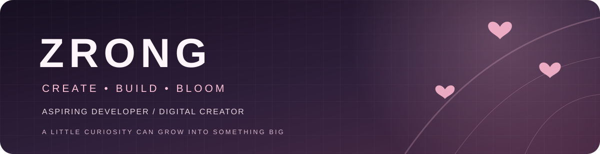
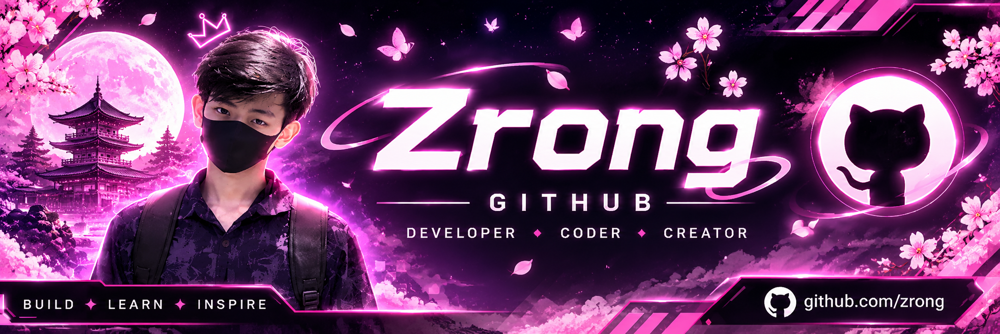
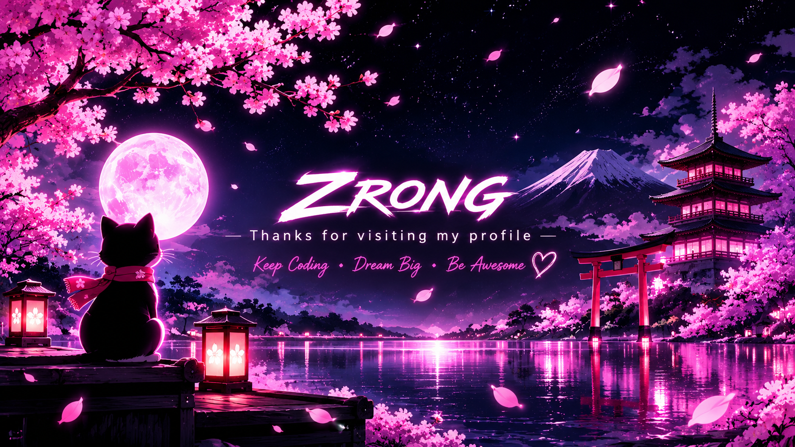

   
  
  
  
  
  
  
  
  
  
  
  
  
  
  
  
  

   
  
  
  
  
  
  
  
  
  
  
  
  
  
  
  
  

[🌸 About](#-about-me) · [🧰 Toolkit](#-technology-toolkit) · [🎯 Focus](#-what-im-learning) · [🚀 Projects](#-featured-projects) · [📊 Stats](#-github-statistics) · [🌱 Journey](#-my-learning-journey) · [💌 Connect](#-connect)

   
  
  
  
  
  
  
  
  
  
  
  
  
  
  
  
  

     

   
  
  
  
  
  
  
  
  
  
  
  
  
  
  
  
  

## 🌸 About Me

Hi, I'm **ZRONG** — an aspiring developer from Cambodia. I enjoy exploring technology and turning ideas into small digital projects. I learn by building, experimenting, reading code, fixing mistakes, and improving each version.

- 🌐 I enjoy creating responsive websites with HTML, CSS, and JavaScript.
- 🤖 I'm exploring AI models, agent concepts, and useful AI interfaces.
- 🐍 I'm learning Python and beginner-friendly programming concepts.
- 📱 I'm interested in Android and desktop app development.
- 🎨 I love thoughtful interfaces, dark themes, soft colors, and smooth motion.
- 🔐 I'm learning secure coding and responsible defensive testing.
- 📚 I enjoy projects that preserve and share Khmer literature.

> *Create with curiosity. Build with patience. Improve a little every day.*

   
  
  
  
  
  
  
  
  
  
  
  
  
  
  
  
  

## 🧰 Technology Toolkit

*These are technologies I use, learn, or explore — not a claim of professional expertise.*

**Languages & Web**

**Frameworks & Runtime**

**Tools & Platforms**

### My creative workflow

| Step | What I do |

| 💡 Idea | Think about a useful feature or a problem to solve |
| 🎨 Design | Plan the layout, colors, and user experience |
| 🧱 Build | Write and organize the code |
| 🧪 Test | Try the project and look for issues |
| 🌱 Improve | Fix, learn, and make the next version better |

## 🎯 What I'm Learning

<b>My current learning map 🌷</b>

| Topic | Current direction |

| Web development | JavaScript fundamentals, responsive design, accessibility |
| UI design | Layout, typography, color systems, micro-interactions |
| Python | Programming fundamentals and small utilities |
| C++ | Understanding performance and core programming concepts |
| AI | Models, agents, local experiments, and AI-powered interfaces |
| App development | Android and desktop application workflows |
| Git & GitHub | Branches, commits, Actions, project documentation |
| Cybersecurity | Secure development, safe testing, and responsible reporting |

### 🌱 A few goals

- [ ] Improve my JavaScript and Python fundamentals
- [ ] Make my projects easier to use on mobile and desktop
- [ ] Learn more about GitHub Actions and automation
- [ ] Keep improving NEXORA AI step by step
- [ ] Add more Khmer reading resources to my library project
- [ ] Write clearer documentation for my repositories

## 🚀 Featured Projects

<table>
<tr>
<td width="50%" valign="top">

### 🤖 NEXORA AI

An ongoing AI project exploring chat, agent workflows, and a custom web experience.

[**View repository →**](https://github.com/getaway416-dotcom/NEXORA-AI)

</td>
<td width="50%" valign="top">

### 📚 Khmer Ancient Library

A digital reading project focused on Khmer classical and ancient literature.

[**Visit website →**](https://khmerancientlibrary.vercel.app/)

</td>
</tr>
<tr>
<td width="50%" valign="top">

### 🧩 404 Pages Collection

A collection of custom error-page designs and front-end experiments.

[**View repository →**](https://github.com/getaway416-dotcom/404-Pages)

</td>
<td width="50%" valign="top">

### 💻 Personal Website

A personal web space for exploring design, layout, and interaction ideas.

[**Visit website →**](https://personal.getaway416.workers.dev/)

</td>
</tr>
</table>

## 📊 GitHub Statistics

 

     

Statistics come from external services and may be delayed or temporarily unavailable. Language charts are repository estimates, not skill rankings.

## 🌿 Recent GitHub Activity

<!-- ACTIVITY:START -->

<i>Recent public GitHub activity will appear here after the workflow runs.</i>

<!-- ACTIVITY:END -->

## Sticker Contribution Garden

## 🌸 My Learning Journey

I believe good projects grow through small steps. I don't need to know everything before starting — I can learn one feature, test it, and improve it.

- **Explore:** find an idea and understand what it needs.
- **Create:** make a first version that works.
- **Learn:** read documentation and understand the tools.
- **Improve:** refine the design, fix bugs, and make it more useful.

<b>Things I enjoy about building projects</b>

- Turning a blank page into a working website.
- Making interfaces feel clear and pleasant to use.
- Discovering a new tool and trying a small experiment.
- Learning how different parts of an app work together.
- Sharing Khmer culture and literature through digital projects.

## 💌 Connect

  

  

**Thanks for stopping by!** 🌸

*May your ideas bloom, one commit at a time.*

