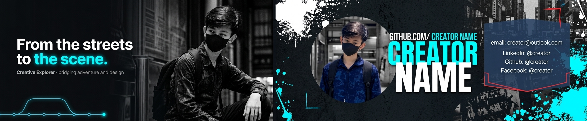
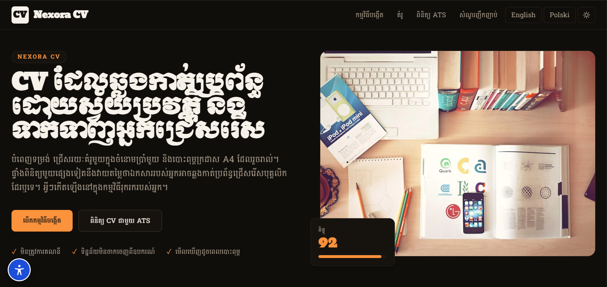
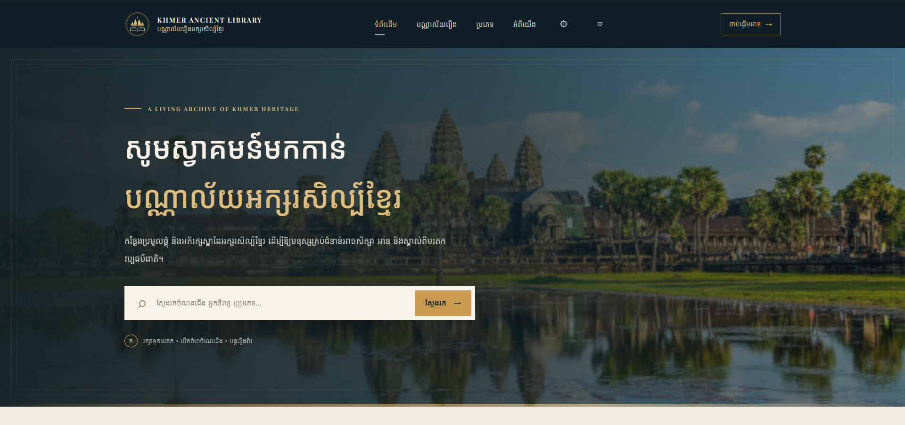
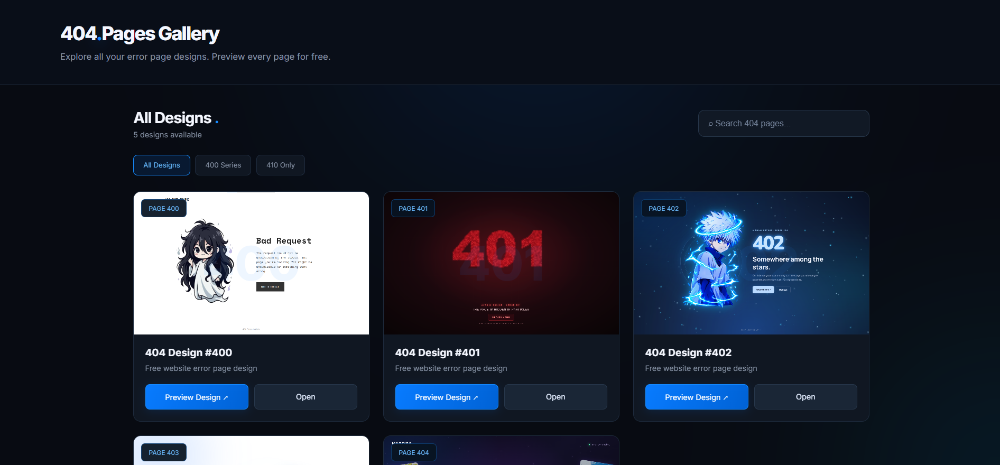

<!-- ═══════════════════════════════════════
     ZRONG — ANIMATED GITHUB PROFILE
     Midnight Blue / Cyan / Purple
════════════════════════════════════════ -->

 

  

---

     

---

 

### Hello, I'm Zrong 👋

**Developer | Creative Thinker | Technology Enthusiast**

I enjoy building websites, experimenting with programming, and turning creative ideas into real projects.

- 🌐 Web Development
- 🐍 Python Programming
- 🎨 UI/UX Design
- 🤖 Artificial Intelligence
- 📱 Android Development
- ⚡ Always learning something new

---

  

  

---

### 1. NexoraCV

A personal CV and portfolio website showcasing my profile, skills, and projects.

**[🌐 LIVE PREVIEW ↗](https://nexoracv.getaway416.workers.dev/)**

### 2. Khmer Ancient Library

A digital library dedicated to Khmer classical literature, Cambodian stories, and cultural preservation.

**[🌐 LIVE PREVIEW ↗](https://khmerancientlibrary.vercel.app/)**

### 3. 404 Pages

A collection of creative and animated website error pages.

**[🌐 LIVE PREVIEW ↗](https://zrong-me.github.io/404-Pages/)**

**[💻 SOURCE CODE ↗](https://github.com/zrong-me/404-Pages)**

### 4. Auto Typer

A Python desktop application for automated typing and local testing.

💻 **[SOURCE CODE ↗](https://github.com/zrong-me/Auto_Typer)**

---

| Project | Description | Preview |
|---|---|---|
| LoveShow | Interactive web experience | [OPEN ↗](https://loveshow.getaway416.workers.dev/) |
| ShowLove1 | Creative love-themed website | [OPEN ↗](https://showlove1.getaway416.workers.dev/) |

Some projects are privately developed. Their source code is not publicly shared.

---

- [ ] Improve JavaScript and React.
- [ ] Develop stronger Python skills.
- [ ] Build more professional websites.
- [ ] Develop my own AI project.
- [ ] Create useful desktop applications.
- [ ] Improve Android development.
- [ ] Master responsive UI/UX design.

---

  

  

**© Zrong — Building ideas into reality.**

